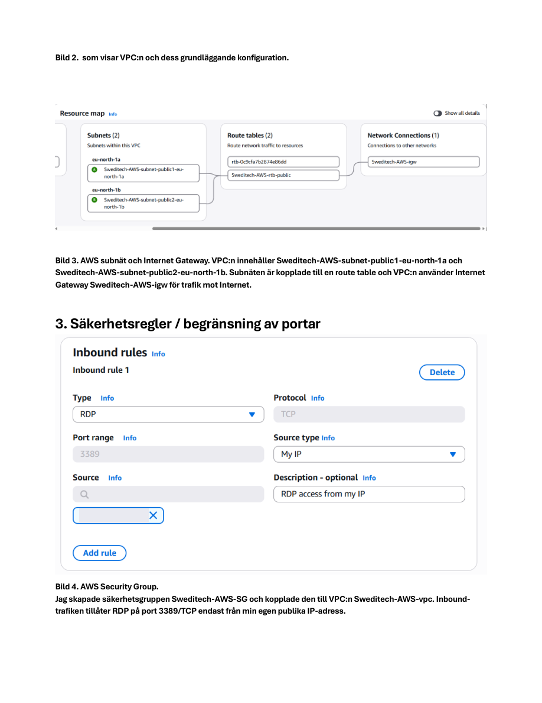
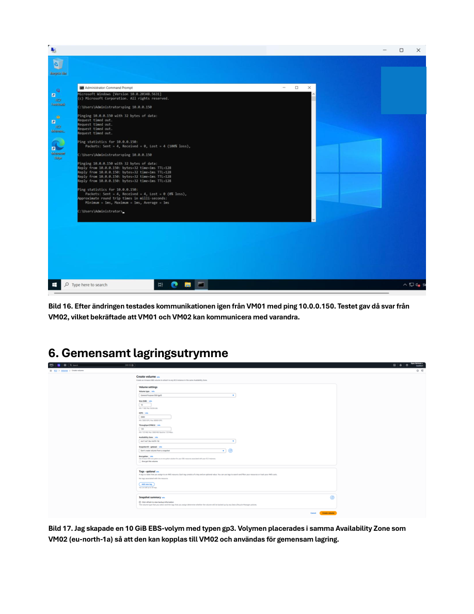
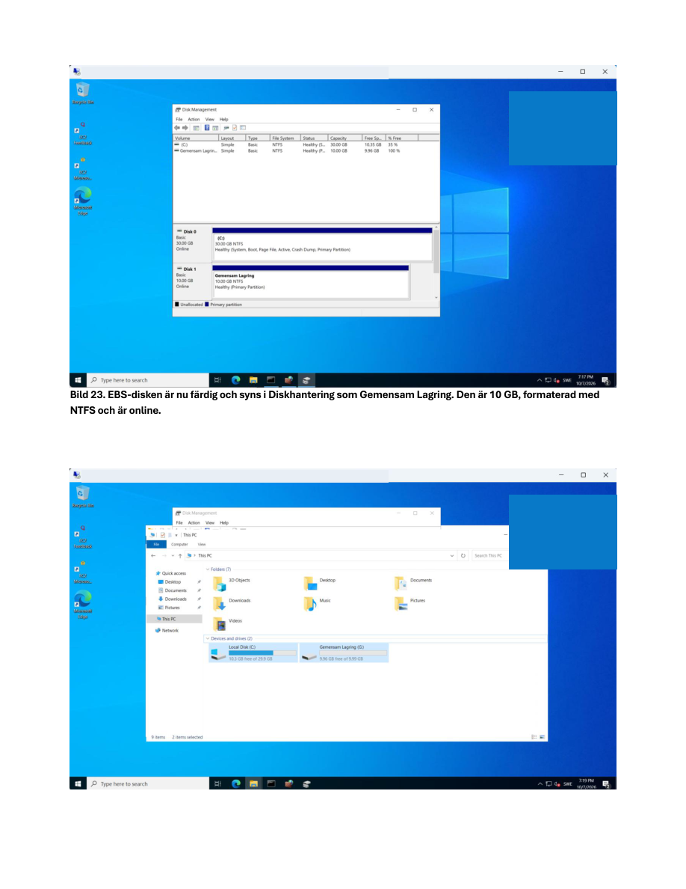
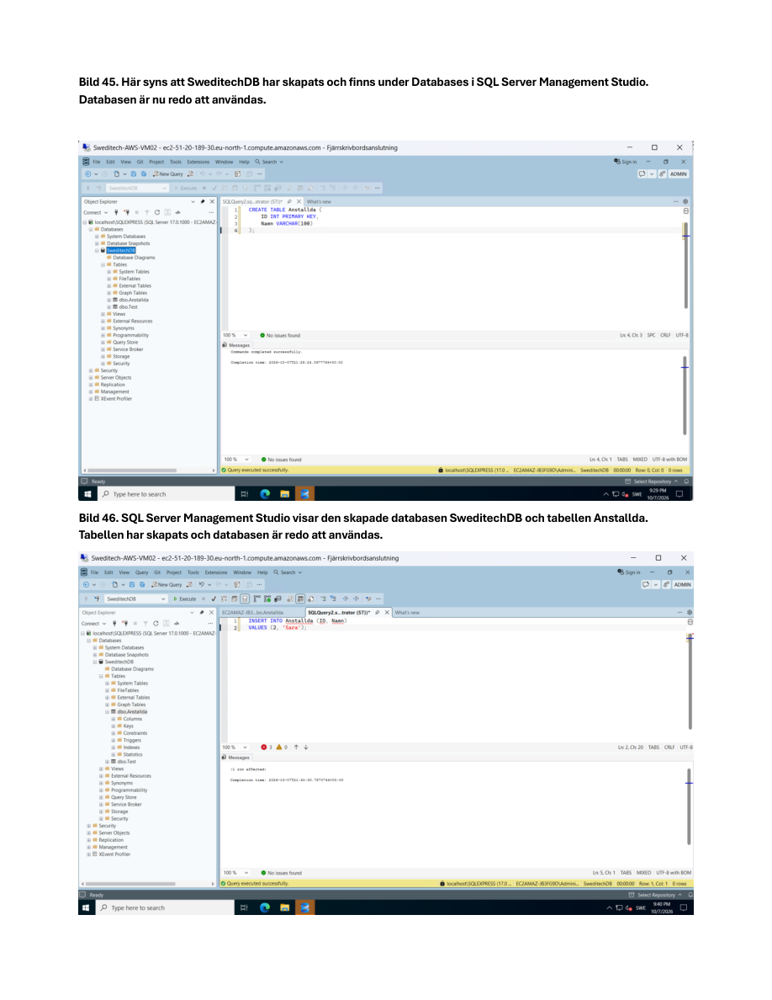

# AWS Infrastructure Lab

<p align="left">
  
</p>


> **Hands-on AWS infrastructure project** demonstrating VPC networking, two Windows Server EC2 instances, security controls, private connectivity, EBS-backed shared storage, and SQL Server database validation.

## Project Summary

This repository documents an AWS infrastructure lab for the fictional company **Sweditech AB**. The purpose was to build a small two-server environment and verify how networking, Windows administration, storage and SQL Server work together.

The environment uses two EC2 instances communicating over private IP addresses. VM02 provides a shared Windows folder backed by a separate EBS volume and also hosts SQL Server Express. VM01 is used to verify network connectivity and access the shared folder.

### Key outcomes

- Created a VPC with subnets, routing and an Internet Gateway
- Deployed two Windows Server EC2 instances
- Configured an AWS Security Group and Windows Firewall rules
- Limited inbound RDP access to the administrator's public IP
- Verified private EC2-to-EC2 connectivity with ping
- Attached and configured an additional **10 GB EBS volume** on VM02
- Shared storage from VM02 and accessed it over SMB from VM01
- Installed **SQL Server 2025 Express** and **SSMS 22**
- Created **SweditechDB** and tested the **Anstallda** table

## Technology Stack

`AWS` · `Amazon VPC` · `Amazon EC2` · `Amazon EBS` · `Security Groups` · `Windows Server` · `Windows Firewall` · `RDP` · `SMB` · `SQL Server 2025 Express` · `SSMS 22`

---

## Architecture

```text
                  AWS VPC
                     |
          Subnets and routing
                     |
           AWS Security Group
                     |
        +------------+------------+
        |                         |
        v                         v
  Sweditech-AWS-VM01       Sweditech-AWS-VM02
  Windows Server           Windows Server
  10.0.24.98               10.0.0.150
        |                         |
        |  Private connectivity   +-- 10 GB EBS volume
        +------------------------>+-- SMB shared folder
        |                         +-- SQL Server Express
        |                         +-- SweditechDB
        |
        +-- SMB access to VM02
            \\10.0.0.150\Gemensam
```

The diagram shows the roles of the two machines and their private communication. It is a simplified lab overview rather than a production reference architecture.

## Network Design

The lab uses an AWS VPC with subnets, routing and an Internet Gateway. The two EC2 instances have private addresses inside the VPC and communicate using those addresses instead of relying on their public endpoints.

| Server | Role | Private IP |
|---|---|---|
| Sweditech-AWS-VM01 | Connectivity tests and shared-storage client | `10.0.24.98` |
| Sweditech-AWS-VM02 | Shared storage and SQL Server | `10.0.0.150` |

The private IPs are included to explain the lab configuration; they are not public internet addresses.

### Network deployment evidence

The screenshot below documents the AWS VPC and network configuration used for the environment.



## EC2 Virtual Machines

### Sweditech-AWS-VM01

VM01 was used to check communication with the other Windows Server instance and access shared files from VM02. This provided a practical way to validate both network reachability and file-sharing functionality from a separate machine.

### Sweditech-AWS-VM02

VM02 provided the storage and database workloads:

- A separately attached 10 GB EBS volume
- A Windows folder shared through SMB
- SQL Server 2025 Express
- SQL Server Management Studio 22
- The SweditechDB test database

Keeping the two instances separate made it possible to test whether services on VM02 were actually reachable from another server.

## Network Security

An AWS Security Group named **Sweditech-AWS-SG** was used alongside Windows Firewall configuration.

The lab included:

- Inbound RDP on TCP 3389 restricted to the administrator's public IP
- ICMP access for the planned private-network connectivity tests
- SMB access for the required file-sharing traffic
- Windows Firewall configuration on the instances

Security Groups control traffic at the AWS network interface level, while Windows Firewall provides host-level filtering. Both must permit the intended traffic for a service to work.

**Security consideration:** RDP and SMB access should remain limited to trusted sources. The lab rules should not be copied directly into a production environment without reviewing source ranges and exposure.

## Private Connectivity Validation

The two Windows Server instances were tested using their private IP addresses. Ping was used to check reachability between the servers.

The goal was to confirm that the instances could communicate across the configured VPC networking and firewall rules.



A successful ping validates ICMP reachability, but does not by itself prove that SMB or SQL Server is accessible. Those services were therefore checked separately in the lab.

## Amazon EBS and Shared Storage

An additional **10 GB Amazon EBS volume** was attached to VM02 and configured in Windows. The volume provided separate block storage for the shared-folder exercise.

The shared folder was configured at:

```text
G:\Gemensam Lagring\Gemensam
```

VM01 accessed the share using the private IP of VM02:

```text
\\10.0.0.150\Gemensam
```

### Storage validation

The practical test consisted of preparing the EBS volume, configuring the Windows shared folder, connecting to it from VM01 and checking access to the shared files.



**Important distinction:** EBS is block storage attached to an EC2 instance. In this lab, the shared access between VMs was provided by **Windows SMB**, not by mounting the same EBS volume directly on both servers.

## SQL Server and Database

SQL Server 2025 Express was installed on VM02. SQL Server Management Studio 22 was also installed on VM02 for local database administration.

The connection used the local named SQL Server instance:

```text
localhost\SQLEXPRESS
```

Windows Authentication was used for the connection.

### Database verification

The lab included:

1. Connecting to the SQL Server Express instance in SSMS
2. Creating the **SweditechDB** database
3. Creating the **Anstallda** table
4. Inserting test records
5. Reading the inserted data to confirm that the database worked

This verified SQL Server installation and local database operations on VM02. It does **not** claim that remote SQL connectivity from VM01 was tested.



## Troubleshooting and Verification

This project brought together several different layers of infrastructure that needed to work in the right order:

- **Networking:** the instances needed valid private addressing and routes
- **Traffic filtering:** AWS Security Groups and Windows Firewall needed to allow the intended tests
- **Storage:** the additional EBS disk needed to be available in Windows
- **File sharing:** the SMB share needed to be reachable from the other VM
- **Database:** SQL Server and SSMS needed to work with the created test database

Testing each part separately helped distinguish network reachability from application-level functionality.

## Validation Checklist

- [x] AWS VPC, subnets and routing configured
- [x] Two Windows Server EC2 instances deployed
- [x] Security Group and Windows Firewall configured
- [x] RDP restricted to the administrator's IP
- [x] Private connectivity checked using ping
- [x] 10 GB EBS volume attached to VM02
- [x] Windows SMB share configured on VM02
- [x] Shared folder accessed from VM01
- [x] SQL Server 2025 Express installed
- [x] SSMS 22 connected to the local SQL instance
- [x] SweditechDB and Anstallda table created
- [x] Database test records inserted and retrieved

## Security Considerations

This is an educational lab rather than a production-hardened environment. A production design would require additional review of identity and access management, patching, logging, backups, network exposure and least-privilege rules.

No passwords, access keys or credentials are intentionally included in this README.

## What I Learned

The lab provided hands-on experience in combining AWS networking, Windows Server administration, storage and SQL Server in one environment. In particular, it reinforced the difference between a successful network test and a working application service, and the relationship between AWS-level and Windows-level firewall controls.

It also demonstrated how EBS block storage can support a Windows file-sharing workload, and how to validate a SQL Server database through SSMS.

## Project Status

**Practical lab completed.** This repository documents the infrastructure implementation and its verification. The screenshots are selected evidence from the original report.

---

*Built as a hands-on cloud and infrastructure lab for portfolio and learning purposes.*